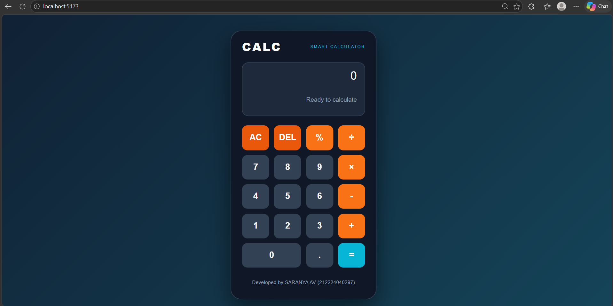
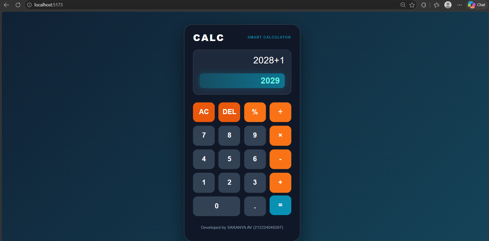

# Ex04 Simple Calculator - React Project

## Date:19-11-2026

## Name : SARANYA AV
## Reg No : 212224040297

## AIM
To  develop a Simple Calculator using React.js with clean and responsive design, ensuring a smooth user experience across different screen sizes.

## ALGORITHM
### STEP 1
Create a React App.

### STEP 2
Open a terminal and run:
  <ul><li>npx create-react-app simple-calculator</li>
  <li>cd simple-calculator</li>
  <li>npm start</li></ul>

### STEP 3
Inside the src/ folder, create a new file Calculator.js and define the basic structure.

### STEP 4
Plan the UI: Display screen, number buttons (0-9), operators (+, -, *, /), clear (C), and equal (=).

### STEP 5
Create a new file Calculator.css in src/ and add the styling.

### STEP 6
Open src/App.js and modify it.

### STEP 7
Start the development server.
  npm start

### STEP 8
Open http://localhost:3000/ in the browser.

### STEP 9
Test the calculator by entering numbers and operations.

### STEP 10
Fix styling issues and refine content placement.

### STEP 11
Deploy the website.

### STEP 12
Upload to GitHub Pages for free hosting.

## PROGRAM

App.jsx
```

import { useState } from "react";
import "./App.css";

function App() {
  const [input, setInput] = useState("");
  const [result, setResult] = useState("");

  const handleClick = (value) => {
    if (value === "=") {
      calculate();
    } else if (value === "AC") {
      setInput("");
      setResult("");
    } else if (value === "DEL") {
      setInput((prev) => prev.slice(0, -1));
      setResult("");
    } else {
      setInput((prev) => prev + value);
      setResult("");
    }
  };

  const calculate = () => {
    try {
      if (!input) return;

      const answer = eval(input);

      if (!Number.isFinite(answer)) {
        setResult("Error");
      } else {
        setResult(answer);
      }
    } catch {
      setResult("Error");
    }
  };

  const buttons = [
    "AC", "DEL", "%", "/",
    "7", "8", "9", "*",
    "4", "5", "6", "-",
    "1", "2", "3", "+",
    "0", ".", "="
  ];

  return (
    <div className="calculator">

      <div className="calculator-header">
        <span className="brand">CALC</span>
        <span className="mini-text">SMART CALCULATOR</span>
      </div>

      <div className="display">
        <div className="expression">
          {input || "0"}
        </div>

        <div className={`answer ${result !== "" ? "show" : ""}`}>
          {result !== "" ? result : "Ready to calculate"}
        </div>
      </div>

      <div className="buttons">
        {buttons.map((button) => (
          <button
            key={button}
            onClick={() => handleClick(button)}
            className={`
              ${button === "=" ? "equals" : ""}
              ${["+", "-", "*", "/", "%"].includes(button)
                ? "operator" : ""}
              ${["AC", "DEL"].includes(button)
                ? "special" : ""}
              ${button === "0" ? "zero" : ""}
            `}
          >
            {button === "*" ? "×" : button === "/" ? "÷" : button}
          </button>
        ))}
      </div>

      <div className="footer">
        Developed by SARANYA AV (212224040297)
      </div>

    </div>
  );
}

export default App;

```
App.css
```

* {
  margin: 0;
  padding: 0;
  box-sizing: border-box;
}

html, body, #root {
  width: 100%;
  min-height: 100%;
}

body {
  font-family: Arial, sans-serif;
  background: linear-gradient(135deg, #0f172a, #164e63);
  min-height: 100vh;
}

#root {
  min-height: 100vh;
  display: flex;
  justify-content: center;
  align-items: center;
  padding: 20px;
}

.calculator {
  width: 340px;
  padding: 25px;
  background: #101827;
  border: 1px solid #334155;
  border-radius: 24px;
  box-shadow: 0 20px 50px rgba(0, 0, 0, 0.5);
}

.calculator-header {
  display: flex;
  justify-content: space-between;
  align-items: center;
  margin-bottom: 22px;
}

.brand {
  color: #ffffff;
  font-size: 27px;
  font-weight: 900;
  letter-spacing: 3px;
}

.mini-text {
  color: #06b6d4;
  font-size: 10px;
  letter-spacing: 1.5px;
}

.display {
  background: #1e293b;
  min-height: 120px;
  padding: 18px;
  border-radius: 15px;
  margin-bottom: 22px;
  text-align: right;
  overflow-wrap: anywhere;
  border: 1px solid #334155;
}

.expression {
  color: #ffffff;
  font-size: 27px;
  min-height: 38px;
}

.answer {
  color: #94a3b8;
  font-size: 14px;
  margin-top: 12px;
  min-height: 38px;
  display: flex;
  align-items: center;
  justify-content: flex-end;
}

.answer.show {
  background: linear-gradient(90deg, #164e63, #0e7490);
  color: #67f5e5;
  padding: 9px 14px;
  border-radius: 10px;
  font-size: 25px;
  font-weight: bold;
  box-shadow: 0 0 18px rgba(6, 182, 212, 0.2);
  animation: resultGlow 0.4s ease;
}

@keyframes resultGlow {
  from {
    opacity: 0;
    transform: translateY(8px);
  }
  to {
    opacity: 1;
    transform: translateY(0);
  }
}

.buttons {
  display: grid;
  grid-template-columns: repeat(4, 1fr);
  gap: 11px;
}

button {
  height: 58px;
  border: none;
  border-radius: 13px;
  background: #334155;
  color: white;
  font-size: 20px;
  font-weight: bold;
  cursor: pointer;
  transition: 0.2s;
}

button:hover {
  background: #475569;
  transform: translateY(-3px);
}

button:active {
  transform: scale(0.94);
}

.operator {
  background: #f97316;
  color: white;
}

.operator:hover {
  background: #ea580c;
}

.special {
  background: #ea580c;
  color: white;
}

.special:hover {
  background: #c2410c;
}

.equals {
  background: #06b6d4;
  color: #ffffff;
}

.equals:hover {
  background: #0891b2;
}

.zero {
  grid-column: span 2;
}

.footer {
  color: #94a3b8;
  text-align: center;
  font-size: 11px;
  margin-top: 22px;
  letter-spacing: 0.5px;
}

@media (max-width: 400px) {
  .calculator {
    width: 100%;
    padding: 18px;
  }
}

```


## OUTPUT





## RESULT
The program for developing a simple calculator in React.js is executed successfully.
